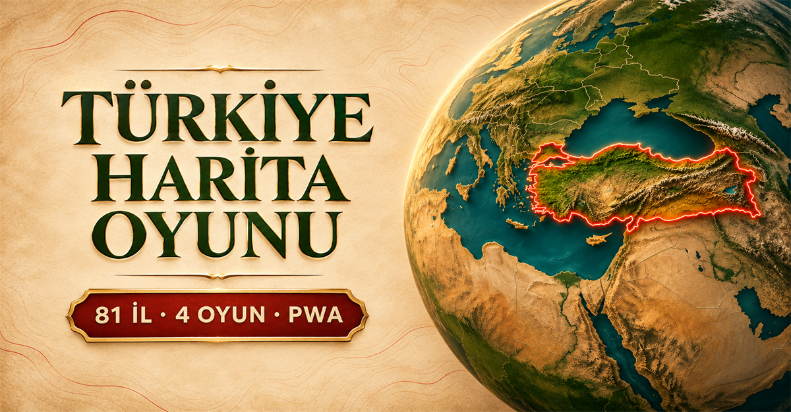
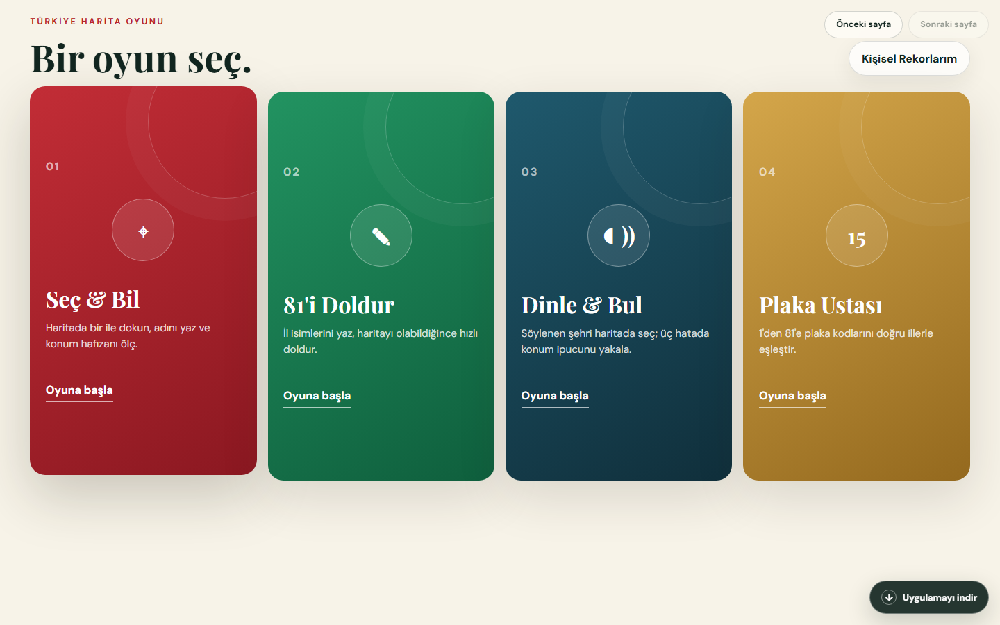
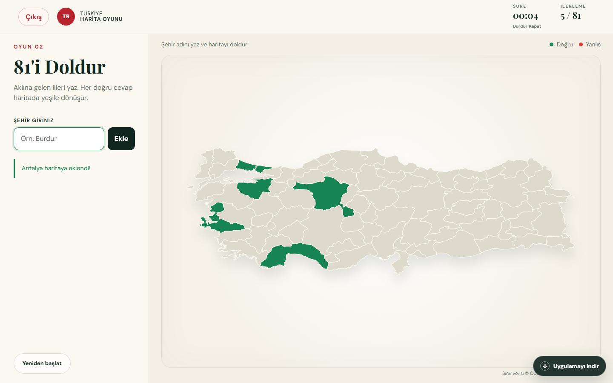
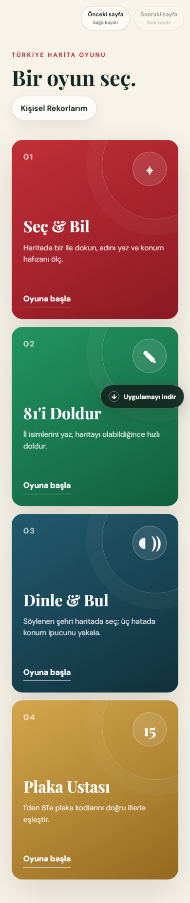

# Türkiye Harita Oyunu



Türkiye'nin 81 ilini dört farklı oyunla öğrenebileceğiniz; telefon, tablet ve bilgisayarda çalışan, kurulabilir ve çevrimdışı kullanılabilir bir PWA.

[Oyunu oyna](https://fetiicolak.github.io/Turkiye-harita-oyunu/) · [17 saniyelik demo videosu](docs/demo/turkiye-harita-oyunu-linkedin.mp4) · [Hazır LinkedIn paylaşım metni](docs/linkedin-post.md)

## Öne çıkanlar

- Gerçek il sınırlarından tarayıcıda oluşturulan etkileşimli SVG Türkiye haritası
- Dört farklı oyun modu ve 81 ilin tamamı
- Kullanıcının **Başla** düğmesiyle kontrol ettiği süre
- Süreyi durdurma, devam ettirme ve kapatma
- Kişisel rekorları cihazda saklama ve görüntüleme
- Sonucu telefonun paylaşım menüsüyle paylaşma veya panoya kopyalama
- Klavye, fare, dokunmatik ekran ve tablet kaydırma desteği
- PWA olarak kurulum ve çevrimdışı çalışma

## Dört oyun modu

- **Seç & Bil:** Haritada bir ile dokunun ve ilin adını tahmin edin.
- **81'i Doldur:** Bildiğiniz il isimlerini yazarak dilsiz haritayı doldurun.
- **Dinle & Bul:** Sesli söylenen ili haritada seçin. Üç yanlış seçimden sonra doğru konum parlar.
- **Plaka Ustası:** 1–81 arasındaki plaka kodlarını doğru illerle eşleştirin.

`Afyon`, `Urfa`, `Antep`, `Maraş`, `İçel`, `İzmit` ve `Adapazarı` gibi yaygın kısa veya eski kullanımlar da kabul edilir.

## Ekran görüntüleri

| Oyun seçimi | Oyun ekranı |
| --- | --- |
|  |  |

### Mobil görünüm



## Süre, kayıt ve paylaşım

Bir oyunu seçtikten sonra sol paneldeki **Başla** düğmesi süreyi ve oyun etkileşimlerini etkinleştirir. Oyun tamamlandığında süre cihazın yerel tarayıcı depolamasına kaydedilebilir ve **Kişisel Rekorlarım** penceresinden görüntülenebilir.

Oyunu erken bitirirseniz tamamlanan ve eksik kalan iller gösterilir. **Sonucu paylaş** düğmesi Web Share API destekli cihazlarda paylaşım menüsünü açar; diğer tarayıcılarda sonucu ve oyun bağlantısını panoya kopyalar.

Kayıtlar sunucuya gönderilmez ve hesap gerektirmez.

## Teknolojiler

- HTML5, CSS3 ve Vanilla JavaScript
- SVG ve GeoJSON
- Service Worker ve Web App Manifest
- Web Speech API, Web Share API ve Local Storage
- GitHub Actions ve GitHub Pages
- Playwright ile masaüstü, mobil ve tablet smoke testleri

## Yerel geliştirme

```powershell
npm install
npx playwright install chromium
npm start
```

Statik ve tarayıcı kontrollerinin tamamını çalıştırmak için:

```powershell
npm test
```

README ekran görüntülerini ve LinkedIn demo videosunu yeniden üretmek için:

```powershell
npm run capture:showcase
```

Teknik kararların geçmişi [Chat.md](Chat.md) dosyasında tutulur.

## Veri ve görsel kaynakları

- İl sınırları: OpenStreetMap katkıcıları ve `theaiagent/turkiye_iller_geojson` (ODbL 1.0).
- Atatürk portresi: `maliozer/ataturk_blackwhite_portrait` (MIT).
- Projeye özel kapaklar, sosyal önizleme ve uygulama ikonları: OpenAI ImageGen.

## Lisans

Uygulama kaynak kodu [MIT Lisansı](LICENSE) ile yayımlanır. Harita verisi ve üçüncü taraf görseller kendi lisanslarına tabidir.
